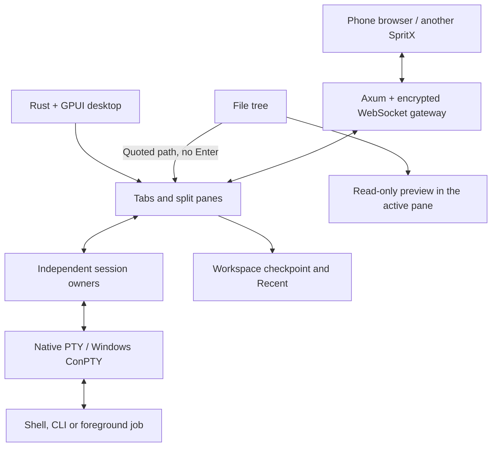
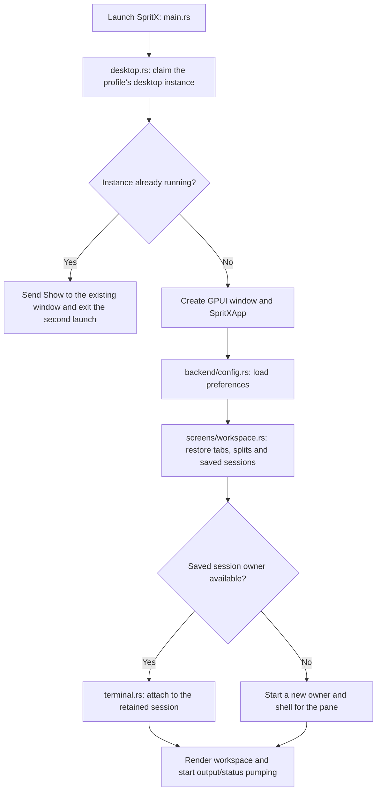
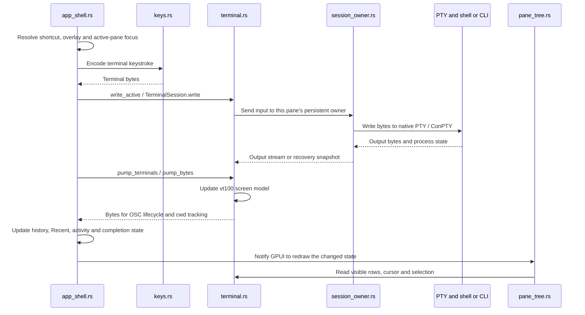
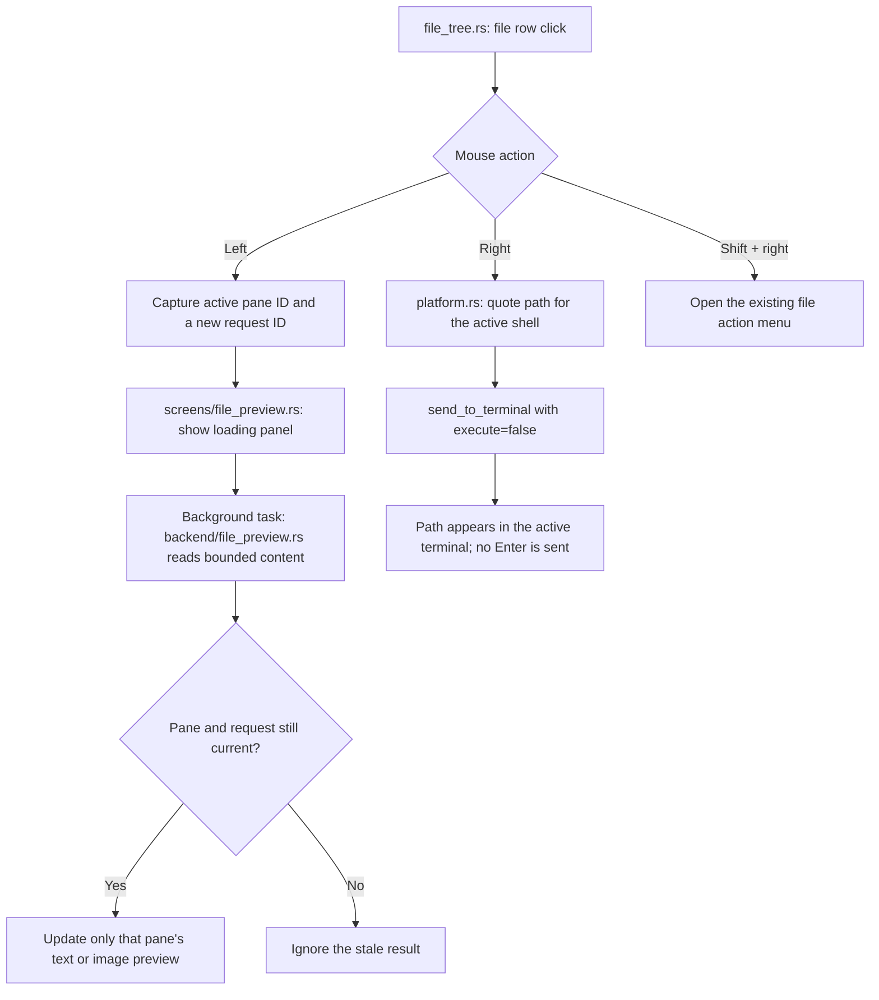

<p align="center">
  
</p>

<h1 align="center">SpritX Terminal</h1>

<p align="center">
  A native Rust terminal for Windows and Linux, with persistent workspaces,<br />
  pane-local file previews and encrypted remote control.
</p>

<p align="center">
  <a href="https://github.com/legacy7838-create/SpritX-terminal/actions/workflows/test.yml"></a>
  <a href="LICENSE"></a>
</p>

<p align="center">
  <a href="#getting-started">Get started</a> ·
  <a href="#everyday-workflow">Workflow</a> ·
  <a href="#remote-control">Remote control</a> ·
  <a href="#configuration">Configuration</a> ·
  <a href="#development-and-testing">Development</a> ·
  <a href="https://discord.gg/ecyzVxaSfV">Discord</a>
</p>

## Introduction

SpritX brings terminal sessions, project files and CLI tools into one desktop workspace. Open tabs, split a tab into independent panes, inspect a file beside the terminal you are using, and return to your projects through Recent. Background session owners and workspace snapshots let the app reconnect to retained sessions instead of always starting with a fresh shell.

The desktop interface is built in **Rust with GPUI** and uses a GPU-rendered terminal backed by native PTYs—ConPTY on Windows. Remote control lets a phone browser or another SpritX instance interact with the same terminal sessions through an encrypted connection. The browser client is embedded in the executable; it uses xterm.js and does not replace the native desktop interface.

## What you can do

| Area | Capabilities |
| --- | --- |
| **Terminal workspace** | Tabs, up to five panes per tab, six layout presets, scrollback, selection, copy/paste, alternate screens and mouse reporting for terminal applications. |
| **Project navigation** | File tree, Git branch and per-file status, background refresh, hide/show controls, Recent projects and per-pane working directories. |
| **File previews** | Read-only text/code with line numbers, supported image previews, scrolling and copy, scoped to the terminal pane where the file was opened. |
| **CLI workflow** | Curated Codex, Claude Code, OpenCode, Pi and Oh My Pi launcher; active-pane, new-tab and split launch actions; activity and completion indicators. |
| **Continuity** | Close-to-tray, reopen the existing app instance, saved tabs/splits/folders/output and reconnection to retained session owners. |
| **Appearance** | Light/dark workspace, twelve terminal themes, custom terminal colors, configurable fonts, cursor styles, blinking and reduced motion. |
| **Remote access** | QR/link pairing, encrypted input/output, phone controls, a native SpritX client, optional HTTPS tunnel and device revocation. |
| **Command tools** | Searchable command palette, filtered history, completion notifications and sound, foreground interrupt and scoped force stop. |

### Appearance and activity

Built-in terminal themes: **SpritX Pastel, SpritX Dark, SpritX Light, Catppuccin Mocha, Catppuccin Latte, Dracula, Nord, Tokyo Night, Gruvbox Dark, Solarized Dark, One Dark and Rosé Pine**. Workspace light/dark mode and the terminal color palette have separate controls. The mobile client also has its own light/dark setting.

The bundled JetBrainsMonoNL Nerd Font Mono supplies prompt glyphs without installing a system font. PowerShell, Bash and Zsh have a two-line Powerline prompt showing the user, folder, Node version when available, and time. The selected font is used across the desktop workspace and terminal panes.

While CLI work is observed, a native **20px Composing orb at 2.05× speed** replaces the tab's terminal icon. Activity detection uses changing live output and submitted input, rather than a fixed list of CLI names. After three quiet seconds, the normal icon returns. **Quiet does not mean finished:** `Done`/`Failed` and completion notifications depend on shell completion markers or process exit. An idle CLI, a silent computation or a network wait may show the normal icon.

## Getting started

### Requirements

| Platform | Requirements |
| --- | --- |
| **Windows** | Windows 10 version 1809+ or Windows 11, Rust MSVC toolchain, Visual Studio Build Tools with Desktop development with C++ and a Windows SDK, and working graphics drivers. Native ConPTY; no WSL required. |
| **Linux** | Wayland or X11 desktop, a current Rust toolchain, graphics drivers/Vulkan runtime and the development libraries listed below. |

Optional tools: **Git** for repository status, **cloudflared** for the public HTTPS tunnel, and whichever CLIs or editor commands you want to launch. SpritX detects the supported installed CLIs; it does not install them.

### Windows: build from source

Run in PowerShell:

```powershell
git clone https://github.com/legacy7838-create/SpritX-terminal.git
cd SpritX-terminal
cargo run dev
```

`cargo run dev` uses Cargo's development profile and passes `dev` to the application. `cargo run` also starts a development build. There is no separate frontend build step for the native UI.

To build and run the release executable:

```powershell
cargo build --release --locked
.\target\release\spritx-terminal.exe
```

The Windows release executable is a GUI application and does not open an extra console window.

### Linux: build from source

On Debian/Ubuntu, install the libraries used by CI:

```bash
sudo apt-get update
sudo apt-get install -y \
  pkg-config build-essential libwayland-dev \
  libxkbcommon-dev libxkbcommon-x11-dev libxcb1-dev \
  libfontconfig1-dev libfreetype-dev libvulkan1

git clone https://github.com/legacy7838-create/SpritX-terminal.git
cd SpritX-terminal
cargo run dev
```

Other distributions need the equivalent development packages. For a release build:

```bash
cargo build --release --locked
./target/release/spritx-terminal
```

The first build compiles the graphics and terminal dependencies and can take several minutes. Development dependencies use `opt-level = 2`; the application uses `opt-level = 1`, with incremental compilation disabled. A local `vendor/xattr` patch keeps GPUI's Unix dependency compatible with the current `libc` API.

Prebuilt package formats and the release workflow are described under [Packaging and releases](#packaging-and-releases).

## Everyday workflow

1. **Open a project.** Start SpritX and change directory in a terminal. Supported shell integration updates that pane's working directory and the file-tree location.
2. **Arrange your workspace.** Use `+` for another tab, split right/down, or choose a layout preset. A tab can hold up to five terminal panes.
3. **Run your tools.** Type a command normally or use one of the five CLI logos at the bottom of the sidebar. Launcher actions can target a new tab or split, and supported tools are rediscovered in the background.
4. **Inspect files beside your work.** Left-click a file to open its preview in the active pane. Right-click a file to insert its path into that terminal without running it.
5. **Follow progress.** Activity indicators show observed work. Confirmed completion can display `Done`/`Failed` and trigger a notification or sound, according to Settings.
6. **Return later.** With the default continuity options enabled, closing the window keeps SpritX in the background. Reopen it from the tray or launch it again to return to the existing instance.

Recent records projects when work starts; simply opening your home/profile directory does not create a project entry. Clicking a Recent item returns to its live pane when available. Saved workspace data can restore layout, folders and output and reconnect to surviving session owners. If an owner is no longer available, SpritX starts a replacement shell; it cannot recover a process that has exited. Recent entries can be removed individually.

### File-tree interactions

| Interaction | Result |
| --- | --- |
| Left-click a folder | Expand or collapse it. |
| Left-click a file | Open a read-only preview with a slide-in panel beside the active terminal. |
| Right-click a file | Insert its shell-quoted path into the active terminal, without Enter or execution. |
| Shift + right-click a file | Open the file action menu. |
| Right-click a folder | Open the folder action menu. |
| Preview copy button / `Ctrl+C` while the preview has focus | Copy the loaded text preview. |
| Preview close button / `Esc` while the preview has focus | Close that pane's preview. |

Previews belong to **pane IDs, not folder paths**. Two terminals in the same folder keep independent preview state. Text previews load the first **64 KiB**; supported PNG, JPEG, WebP, GIF and BMP images are limited to **8 MiB / 16 million pixels**, with a static thumbnail for display. UTF-8 and BOM-marked UTF-16 text are supported. Very long displayed lines are capped at 4,096 characters. Binary, unavailable or oversized files show an explanatory state. A preview never edits or executes the file.

### Close, reopen and quit

- **Window close:** with `closeToTray` enabled, keep the app and sessions in the background. If a tray is unavailable, the app minimizes instead.
- **Tray → Open SpritX / launch again:** show the existing application instance.
- **Close a pane/tab:** end the sessions belonging to that pane/tab. The last tab can be closed, leaving an empty workspace; `+` creates a terminal again.
- **Tray → Quit SpritX:** explicitly terminate the desktop app and its owned sessions.

When testing a newly built executable, a retained older instance may reopen instead. Finish any active work and quit the old instance before launching the updated build.

### Interrupt a running command

| Control | Behavior |
| --- | --- |
| `Ctrl+C` / terminal menu → Interrupt process | Interrupt the foreground job while keeping its shell available. |
| `Ctrl+Shift+K` / terminal menu → Force stop & restart | Stop that local pane's process tree and restart its shell in the same folder. Other panes are unaffected. |
| `Ctrl+D` | Send EOF where the shell/program supports it. |
| `Ctrl+Z` on Linux | Suspend the foreground job; use `fg` to resume. |
| `Ctrl+\` on Linux | Send the terminal quit character (`SIGQUIT`). |
| `Ctrl+Z`, then Enter on Windows | EOF for console readers that support that convention. |

Programs can handle or ignore interrupts. Force stop is an explicit fallback and resets that pane's live screen. Native shell tools such as `kill`, `Stop-Process` and `taskkill` remain available; SpritX does not substitute runtime-specific kill commands into your input.

## Remote control

### Connect a phone or browser

1. Click the **phone icon** in the desktop toolbar and select **Start sharing**.
2. Scan the QR code or open the pairing link on the other device.
3. Complete pairing, select a terminal and interact with the same session running on the desktop.
4. Use **Stop sharing** to close active bridges and stop the tunnel. Individual paired devices can also be revoked.

The default port is **4530**. If automatic tunneling is enabled and `cloudflared` is available, SpritX binds locally and starts an HTTPS quick tunnel. Otherwise it uses the LAN interface, so the device needs network access to that machine.

Pairing codes are **single-use and expire after 10 minutes**. That is separate from sharing duration: a successfully paired device keeps its own device key for reconnection. Connections can still drop when the network disappears or a browser stops sending keepalives; stopping sharing or revoking a device cuts its access.

### Connect another SpritX

Open the command palette and paste the pairing link to connect to a remote SpritX from a native pane. The same protocol is used between Windows and Linux hosts/clients.

### Mobile controls

The embedded browser UI includes a terminal picker, extra keys (`Esc`, `Tab`, `Ctrl`, arrows, `Ctrl+C`, `Ctrl+L`, `Ctrl+D`), path-completion chips, font sizing, light/dark mode and sound controls. Touch input supports mouse-aware terminal applications. The terminal fits the connected device, and the desktop pane takes its size back when the last remote client leaves.

Desktop and mobile theme preferences can be changed independently. The browser loads xterm.js, its fit/WebGL addons and tweetnacl from jsDelivr with SRI hashes, so it needs Internet access to load those dependencies.

### Transport and access

After the pairing handshake, terminal/control frames use NaCl **secretbox (XSalsa20-Poly1305)** with per-session keys and ordered counters. The pairing secret is carried in the URL fragment, which is not sent in HTTP requests. Failed handshakes are refused rather than downgraded to plaintext.

A paired device can control the exposed terminal sessions. Share pairing links only with intended users and revoke devices when access is no longer needed.

## Keyboard shortcuts

`Ctrl` applies on Windows/Linux. The code also recognizes the platform command modifier where available.

| Shortcut | Action |
| --- | --- |
| `Ctrl+T` | New tab |
| `Ctrl+W` | Close active pane |
| `Ctrl+Tab` / `Ctrl+Shift+Tab` | Next / previous tab |
| `Ctrl+Shift+]` / `Ctrl+Shift+[` | Next / previous tab |
| `Ctrl+1` … `Ctrl+9` | Select a tab |
| `Ctrl+Shift+D` / `Ctrl+Shift+E` | Split right / down |
| `Alt+←/→/↑/↓` | Move focus between panes |
| `Ctrl+Shift+P` | Command palette |
| `Ctrl+Shift+H` | Command history |
| `Ctrl+,` | Settings |
| `Ctrl+Shift+C` / `Ctrl+Insert` | Copy terminal selection |
| `Ctrl+Shift+V` / `Shift+Insert` | Paste into the terminal |
| `Ctrl+Shift+A` | Select all terminal text |
| `Ctrl` + `+` / `-` / `0` | Increase / decrease / reset terminal font size |
| `Shift+PgUp` / `Shift+PgDn` | Scroll ten lines |
| `Esc` | Close the current overlay, or the focused file preview |

The command palette supports action filtering, arrow-key selection, Enter to activate and pasted remote links. Its search caret blinks while the focused field is empty and stays steady once text is entered. History supports filters including `failed`, `ok`, `here`, `cwd:`, `project:` and `branch:`.

## Configuration

Open **Settings** to change Appearance, Shell, Notifications, File tree, Remote, History, Shortcuts or General preferences. About includes version and license information.

| Platform | Configuration directory |
| --- | --- |
| Windows | `%APPDATA%\spritx\` |
| Linux | `$XDG_CONFIG_HOME/spritx/`, falling back to `~/.config/spritx/` |

`config.toml` stores preferences, `history.jsonl` stores recorded command history, and `sessions/workspace.json` stores the workspace checkpoint. Remote device credentials also live under the configuration directory. Writes are atomic; Unix permissions are restricted, and malformed configuration is backed up as `config.toml.broken`.

A partial configuration is valid: omitted fields keep their defaults. For example:

```toml
[appearance]
lightWorkspace = false
fontFamily = "JetBrainsMonoNL Nerd Font Mono"
fontSize = 14
cursorStyle = "block"
cursorBlink = true
scrollback = 5000

[behavior]
closeToTray = true
restoreWorkspace = true
keepSessions = true
saveTerminalOutput = true
reducedMotion = false

[shell]
args = []

[notifications]
enabled = true
minDurationSec = 10
sound = true

[remote]
port = 4530
autoTunnel = true
```

| Section | Purpose / additional keys |
| --- | --- |
| `[appearance]` | Font, cursor, scrollback, workspace mode; `[appearance.theme]` holds the custom terminal palette. |
| `[behavior]` | Continuity and motion options; also `focusFollowsMouse`, `showGitBranch`, `persistBlocks`. |
| `[shell]` | Optional `program` and an argument array. |
| `[notifications]` | Completion notification, duration threshold and sound. |
| `[fileTree]` | `dirList`, `dirOpen`, `fileView`, `fileEdit`, `fileOpen`; `{path}` is quoted for the running shell. |
| `[cliLauncher]` | Supported-tool paths and launcher preferences (`manual`, `pinned`, `hidden`). |
| `[remote]` | Sharing port and automatic tunnel preference. |
| `[history]` | `enabled` and `ignore` patterns; default exclusions include password/token/secret-like command patterns. |
| `[keybindings]` | Stored action-to-keystroke mappings. |

### Shell integration

| Shell | Integration |
| --- | --- |
| Windows PowerShell / PowerShell 7 | Embedded initialization passed through an encoded command; cwd and OSC 133 command lifecycle tracking. Native `curl.exe` is resolved for the familiar `curl` alias when available. |
| Bash / Zsh | Bundled prompt scripts for cwd, command text, lifecycle markers and Powerline prompt styling. |
| Fish | Cwd and pre/post-command hooks. |
| cmd.exe | Terminal operation and shell-specific file actions; no automatic cwd/rich-history integration. |

An empty shell argument list enables the integration defaults. Explicit custom arguments replace those defaults, so completion/history/cwd features depend on what that shell then emits. Select a full executable path in **Settings → Shell**, such as `C:\Program Files\PowerShell\7\pwsh.exe`; changes apply to new sessions.

Bash/Zsh wrappers are generated under SpritX's configuration directory and source the user's existing rc file first. Optional sibling `scripts/spritx-shell-init.bash` / `.zsh` files are loaded only if present; the bundled integration does not require those development files. SpritX does not rewrite your normal shell profile.

## How the project works



The terminal pump processes PTY output into the `vt100` screen model. Shell markers supply working-directory and command-lifecycle events. The UI renders that state, while session owners retain the underlying processes separately from the desktop window. Workspace checkpoints record how to restore or reconnect panes.

File discovery, preview loading and terminal startup/teardown use background work to keep blocking filesystem/process operations out of interactive UI handlers. Preview requests carry pane and request identities, so a late result cannot overwrite a newer selection or reopen a removed preview.

### Developer workflow: follow the code

The repository map below locates files. These flows show **what runs first, which module receives the next step, and where the result becomes visible**.

#### 1. Application startup and session recovery



Start reading at [`main.rs`](src/main.rs), then [`desktop.rs`](src/desktop.rs) and `SpritXApp::new` in [`app_shell.rs`](src/screens/app_shell.rs). Recovery is implemented by `restore_workspace` and `restore_pane_session` in [`screens/workspace.rs`](src/screens/workspace.rs); the saved format lives in [`backend/workspace.rs`](src/backend/workspace.rs).

An explicitly saved empty workspace stays empty. The diagram's session recovery steps apply only when there are panes to restore.

Session owners use the same executable with the internal `--session-owner` argument. `main.rs` routes that mode directly to `backend/session_owner.rs` instead of creating another GPUI window.

#### 2. Keyboard input, process output and rendering



This is the normal persistent local-session path. Smoke tests use direct local PTY sessions, which bypass the owner connection. Rendering reads the parsed screen; it does not execute the command or interpret a second copy of the raw output.

To trace a terminal bug, follow `type_key` → `write_active` in [`app_shell.rs`](src/screens/app_shell.rs), then `TerminalSession::write` / `pump_bytes` in [`terminal.rs`](src/terminal.rs). Command/cwd markers are handled by [`backend/osc.rs`](src/backend/osc.rs); visible row layout and mouse-to-cell mapping live in [`pane_tree.rs`](src/screens/pane_tree.rs).

#### 3. File click to pane-local preview or terminal path



[`file_tree.rs`](src/screens/file_tree.rs) chooses the interaction. [`screens/file_preview.rs`](src/screens/file_preview.rs) owns the pane/request identity, loading state, slide transition and close behavior. [`backend/file_preview.rs`](src/backend/file_preview.rs) only loads and validates content. [`pane_tree.rs`](src/screens/pane_tree.rs) places the viewer beside its owning terminal.

Keep preview state keyed by **leaf/pane ID**, not cwd or filename. Keep file reads off the UI thread, and check request identity again before applying an async result. The viewer has its own input focus so ordinary typing into a focused preview is not forwarded to the shell.

#### 4. Workspace, activity and remote event flows

| Event | Code path | Result |
| --- | --- | --- |
| New tab or split | `app_shell.rs` action → `state.rs` pane tree → `terminal.rs` / `session_owner.rs` | An independent terminal session is assigned to a new pane ID. New-tab startup runs in the background. |
| Shell changes directory | Shell integration → `terminal.rs` output → `backend/osc.rs` → `app_shell.rs` | Update the owning pane's cwd and the corresponding file-tree context. |
| CLI produces work or finishes | Output/input activity → `backend/cli_activity.rs`; confirmed completion → OSC/process status → `screens/workspace.rs` / `platform.rs` | Update the tab/Recent indicator; emit configured completion notifications. Silence alone is not completion. |
| Workspace checkpoint | `screens/workspace.rs::checkpoint_workspace` → serialized snapshot → `backend/config.rs` background writer | Save layout, Recent and session reconnection data without doing the durable write in an interactive UI handler. |
| Window closes to background | `main.rs` close handler → `prepare_for_background` → `desktop.rs` | Checkpoint, retain the running instance and hide/minimize its window. |
| Explicit desktop quit | Tray action → `screens/workspace.rs::quit_desktop` | Flush pending state and stop owned sessions before quitting. |
| Phone sends input | Browser client → sealed frame → `backend/remote_server.rs` → `app_shell.rs::pump_remote` → target `TerminalSession` | The same host-side terminal receives the input. |
| Host sends remote output | Terminal pump → remote server screen/output bridge → sealed frame → browser renderer | Remote clients receive the host's output; remote sessions do not spawn duplicate local shells. |
| Native SpritX connects remotely | Pairing link in palette → `backend/remote_client.rs` → remote pane in `terminal.rs` | Render and control a session owned by the other SpritX host. |

#### 5. Where to make a change

| Change | Start here | Relevant verification |
| --- | --- | --- |
| Input, control keys or process interrupts | [`keys.rs`](src/keys.rs), [`app_shell.rs`](src/screens/app_shell.rs), [`terminal.rs`](src/terminal.rs) | `keys_model`, `process_interrupt`, `terminal_backend` |
| Terminal rows, cursor, wrapping or selection | [`terminal.rs`](src/terminal.rs), [`pane_tree.rs`](src/screens/pane_tree.rs) | `terminal_regressions`, `terminal_appearance`, `latency` |
| Tabs, splits or workspace recovery | [`state.rs`](src/state.rs), [`workspace.rs`](src/screens/workspace.rs), [`session_owner.rs`](src/backend/session_owner.rs) | `state_model`, `workspace_restore`, `workspace_owner`, `tab_lifecycle` |
| File-tree actions or previews | [`file_tree.rs`](src/screens/file_tree.rs), [preview UI](src/screens/file_preview.rs), [preview loader](src/backend/file_preview.rs) | `backend_fs_osc`, `file_preview`, `file_preview_ui` |
| Settings, palette or desktop colors | [`overlays.rs`](src/screens/overlays.rs), [`config.rs`](src/backend/config.rs), [`theme.rs`](src/theme.rs) | `backend_config_history`, `ui_smoke` |
| Remote pairing or transport | [`remote.rs`](src/backend/remote.rs), [`remote_server.rs`](src/backend/remote_server.rs), [`remote_client.rs`](src/backend/remote_client.rs) | `backend_remote`, `backend_remote_server`, `backend_remote_client` |
| CLI activity or launcher behavior | [`cli_activity.rs`](src/backend/cli_activity.rs), [`cli_launcher.rs`](src/screens/cli_launcher.rs) | `cli_activity` and the launcher/library tests |
| Branding or packaged assets | [`build.rs`](build.rs), [`assets.rs`](src/assets.rs), [`assets/`](assets/) | Asset/library tests and a packaged binary check |

For a feature change: identify the owning pane/action → update the view and state transition → put blocking work in the backend/background executor → add focused regression coverage → run the relevant model/backend tests → run display tests when the change affects layout or interaction. The commands and display-test opt-ins are listed in [Development and testing](#development-and-testing).

The asset path is separate from terminal execution: `build.rs` embeds icon/brand tables and compiles the Windows icon resource → `assets.rs` exposes embedded data to GPUI → views load it without depending on the source checkout. For distribution, the test workflow validates the commit first, and the manually dispatched release workflow builds the platform packages.

### Repository map

```text
src/
  main.rs                 Desktop startup, window, tray and instance handling
  desktop.rs              Background/reopen lifecycle and tray integration
  terminal.rs             PTY sessions, screen model, rendering and selection
  platform.rs             OS paths, shell defaults and path quoting
  platform/powershell.rs  Windows shell integration
  keys.rs                 Keyboard-to-terminal byte encoding
  state.rs                Tabs, panes, layouts and settings state
  theme.rs                Desktop theme tokens
  theme_presets.rs        Terminal palette presets
  screens/
    app_shell.rs          Application actions, state and terminal pump
    pane_tree.rs          Pane layout and terminal interaction
    tab_bar.rs            Tab strip, toolbar and context menu
    tab_motion.rs         Measured tab transitions
    file_tree.rs          Project tree, refresh, Git badges and file actions
    file_preview.rs       Pane-local file viewer and transitions
    cli_launcher.rs       Curated tool discovery and launch actions
    workspace.rs          Checkpoint restore, Recent and owner status
    overlays.rs           Settings, palette and remote panels
  backend/
    config.rs             Preference storage and atomic writes
    files.rs, git.rs      Filesystem and repository information
    file_preview.rs       Bounded text/image preview loading
    workspace.rs          Saved workspace format and Recent project rules
    session_owner.rs      Retained sessions and reconnect protocol
    osc.rs, history.rs    Shell markers and command-history search
    remote*.rs            Pairing, encryption, server and native remote client
  components/             Shared native UI controls and activity orb
assets/                   Embedded logos, icons, fonts and shell scripts
tests/                    Model, backend, terminal and native-window tests
packaging/                Linux package manifests and launchers
.github/workflows/        Tests, manual build and gated release jobs
build.rs                  Embedded asset tables and Windows icon resource
```

## Development and testing

Run from the repository root:

```bash
cargo check --locked --tests
cargo test --locked
cargo build --release --locked
```

Display-dependent tests are ignored by the default test run. On a machine with a working desktop, run them explicitly:

```bash
cargo test --test ui_smoke -- --ignored --test-threads=1
cargo test --test tab_lifecycle -- --ignored --test-threads=1
cargo test --test file_preview_ui -- --ignored --test-threads=1
```

The Windows tray lifecycle test has an additional opt-in:

```powershell
$env:SPRITX_UI_TESTS = "1"
cargo test --test desktop_lifecycle -- --test-threads=1
Remove-Item Env:SPRITX_UI_TESTS
```

Setting `SPRITX_UI_TESTS=1` alone does **not** unignore the other display tests. Some process-control tests need optional external runtimes such as Node/npm/Bun; inspect their test prerequisites before running them.

CI runs the default test suite on **Ubuntu and Windows** for pushes and pull requests. GUI, physical phone and distribution-specific tray behavior need separate live verification; a default CI pass does not imply all of those scenarios ran. Existing verification notes are in [BUGFIX-VALIDATION.md](BUGFIX-VALIDATION.md) and [TAB-SMOOTHNESS-REPORT.md](TAB-SMOOTHNESS-REPORT.md).

### Runtime diagnostics

| Variable | Purpose |
| --- | --- |
| `SPRITX_QUIET=1` | Silence routine profiling output. |
| `SPRITX_PROFILE=1` | Enable latency profiling in release builds; debug builds enable it by default. |
| `SPRITX_ROWS=1` / `SPRITX_FRAMES=1` | Add row-level / frame-level profiling detail. |
| `SPRITX_MEM=1` | Enable memory profiling in release builds. |
| `SPRITX_MEM_BACKTRACE=1` | Add allocation attribution. |
| `SPRITX_OPEN=palette` | Open the command palette at startup; `settings`, `remote` and `remote-menu` are also supported. |
| `SPRITX_SMOKE=1` | Exit after approximately three seconds; isolated test runs use direct sessions. |
| `SPRITX_DEBUG_KEYS=1` | Log keyboard events for local debugging. |

Key logging can include entered text; use it deliberately when diagnosing input issues.

## Packaging and releases

The [release workflow](.github/workflows/release.yml) is manually dispatched and requires a successful test-workflow run for the same commit. Version/tag values come from `Cargo.toml`.

| Format | Target |
| --- | --- |
| Windows portable ZIP | Windows x86-64; executable, README and MIT license |
| Flatpak | Linux cross-distribution bundle |
| AppImage | Linux portable executable |
| DEB | Debian/Ubuntu family |
| RPM | Fedora/RHEL family |
| Arch package | Arch-based systems |

The executable embeds its UI assets. The Linux package definitions install the desktop launcher and app icon; the Windows build embeds the `.ico` resource. Release formats are described by the workflow; check the repository's [Releases page](https://github.com/legacy7838-create/SpritX-terminal/releases) for the assets actually published for a version.

Before running a downloaded AppImage:

```bash
chmod +x SpritX-*-x86_64.AppImage
./SpritX-*-x86_64.AppImage
```

## Contributing and community

Open an issue with the operating system, shell, reproduction steps and relevant diagnostic output. For changes, keep Windows/Linux behavior in mind, include focused regression coverage when needed, and describe which runtime checks were actually performed.

Join the [SpritX Discord community](https://discord.gg/ecyzVxaSfV). The same invite is available from the Discord icon beside remote control in the desktop toolbar.

## License and credits

SpritX is licensed under the **MIT License**. See [LICENSE](LICENSE).

Bundled resources retain their own notices:

- [Hugeicons](assets/icons/LICENSE-Hugeicons.txt) and [LobeIcons](assets/icons/LICENSE-LobeIcons.txt) interface assets.
- [CLI brand artwork and source credits](assets/brands/README.md).
- [JetBrainsMonoNL Nerd Font Mono](assets/fonts/README.md), under the [SIL Open Font License](assets/fonts/OFL.txt).
- Native Composing orb adapted from Thinking Orbs; [upstream MIT notice](assets/licenses/Thinking-Orbs-MIT.txt).
- [SpritX mascot artwork and icon exports](assets/APP-ICON.md).
